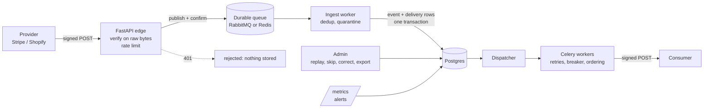

# Webhook gateway

One service that sits in front of a company's webhook handlers. It receives events, checks they are genuine, stores them
durably, delivers them reliably, and lets a human see, fix and replay any of them.

Webhooks are fire-and-forget. Without something like this, a script that is down for two minutes loses events, the same
order gets processed twice, anyone can POST to your URL, and when something breaks nobody can answer "did event X arrive,
and what happened to it?"

**Try it:** `./demo.sh`, then open <http://localhost:8080/play/>. It is a 3D neon city you can orbit with the mouse, and
every part of it is a real part of the gateway: three launch pads fire real signed Stripe-style and Shopify-style webhooks
(and a fake-webhook pad fires forged ones) at the real edge. A scanner ring checks each signature, a glass tube holds the
durable queue (it visibly fills when you switch the ingest worker off), a gear turbine does the dedup, a tower of discs
grows by one for every event stored in Postgres, delivery drones fly to two consumer skyscrapers (their windows go dark
when the consumer is down, and a force-field dome closes when the circuit breaker trips), and failed deliveries end up in a
graveyard you can replay from. **Ride along** puts a chase camera on a webhook for its whole journey, and a trace panel
ticks off the real steps with real numbers. The animation is slowed down so a viewer can follow it (a note on screen shows
the real edge time, usually a few milliseconds); there is a faster pace setting. Nothing on that page is mocked.

**Crash the queue:** pick a transport (RabbitMQ, Redis with an append-only file, or Redis with no persistence at all), switch the
ingest worker off, fire a burst so acknowledged webhooks pile up in the queue, then press *crash the queue*. That runs a real
`kill -9` on the broker's container and restarts it, and a banner reports what survived. RabbitMQ and Redis-with-AOF keep
every webhook; Redis with no persistence loses all of them, even though the edge had answered 200 for each. (This button mounts
the Docker socket, so it is only enabled by `demo.sh` via `docker-compose.chaos.yml` and must never be exposed publicly.)
Three.js (MIT) is vendored under `core/playground/static/playground/vendor/` so the demo works offline.




## What it promises, in plain words

1. **No accepted event is lost.** The edge says 200 only after the queue has confirmed the message is durable. If the queue
   cannot confirm, the edge answers 503 and the provider retries. It never answers a false 200.
2. **At-least-once delivery, not "exactly once".** Exactly-once delivery over a network is not possible: if we send an event
   and the consumer's reply is lost, we cannot know whether it was processed, so we send again. What we do guarantee: every
   delivery carries the same stable event id (`X-Gateway-Event-Id`) and an attempt number, so a consumer can ignore repeats.
   Duplicates from the *provider* are dropped at the door and never reach the consumer at all.
3. **A failing consumer never blocks another.** Per-consumer in-flight cap, retry with backoff and jitter, and a circuit
   breaker that pauses a consumer that keeps failing. Events wait; none are dropped.
4. **Every event has a visible life**: received, stored, queued, attempts with timings and response codes, replays, who did
   what. The admin shows it in plain words ("what happened") on the event page.
5. **A human can find any event in under a minute and replay it**, one at a time or in bulk (dry run first, rate limited).

## What is in it

| Area | What it does |
|---|---|
| Edge (FastAPI) | Verifies Stripe-style (timestamped HMAC) and Shopify-style (base64 HMAC) signatures on the **raw** body with a constant-time compare. 5-minute replay window checked against the time the edge *received* the request. Size and content-type limits. Per-source rate limit (429 + Retry-After). Two secrets valid at once during a rotation. Bad-signature log with a disk cap. |
| Dedup | Event id when the provider sends one, otherwise a hash of the body (only matching within 24 h). Same id + same body: dropped and counted. Same id + different body: kept in a conflicts table and an alert is raised. Dedup keys are never deleted. |
| Quarantine | Valid signature but a stale timestamp: stored, flagged, alerted, **never delivered**. |
| Delivery | Transactional outbox (delivery rows commit with the event). Retries: 14 attempts, 30 s doubling to a 1 h cap, +0-25% jitter (covers about 7 hours of outage), `Retry-After` honoured, other 4xx fail at once. Dead letters are kept forever and replayable. |
| Ordering | Opt-in per subscription, per key (e.g. one Shopify order id). One delivery in flight per key, in arrival order, parallel across keys. A dead event holds its key until a human replays or skips it. Needs a **single ingest worker** (see Scaling). |
| Admin | Event list with filters, raw body exactly as received, every delivery attempt, replay and skip actions, bulk replay with a dry-run confirmation page, CSV export, event corrections, audit log. |
| Corrections | The raw body is immutable. A fix is a separate row merged in at delivery time (`X-Gateway-Corrected: true`). |
| Operations | `/metrics` (Prometheus) and `/stats.json`. Alerts to a webhook: dead count, queue age, quarantined events, conflicts, paused consumers, **silent sources** (a source quiet for longer than its learned normal gap at that hour). Retention: raw bodies deleted after 30 days, metadata kept. |
| Transports | RabbitMQ or Redis, same promises, chosen per request in dev. |

Decisions and the reasons behind them are in [`docs/DECISIONS.md`](docs/DECISIONS.md).

## Run it

```bash
./demo.sh                      # whole stack, retries slowed to a watchable pace
open http://localhost:8080/play/      # the animated range
open http://localhost:8080/admin/     # admin / admin (dev only)
docker compose down -v
```

Send one yourself (sign `"<timestamp>.<body>"` with the source secret from `dev/sources.json`; see `e2e/crash_tests.py`
for a ten-line signer).

Production values are the defaults. The test and demo stacks scale time down with `DELIVERY_TIME_SCALE`
(`0.02` in tests, so hours of backoff run in seconds).

## Proof

Everything below is run against the real stack (real edge, real broker, real worker, real Postgres), by
`./e2e/run_all.sh`, which starts six isolated stacks and runs every shard **in parallel** (about three minutes in total).
Unit tests: `docker compose --profile test up core-test` (core) and `cd edge && pytest` (edge).

**Nothing accepted is lost: crash tests**

| Test | Result |
|---|---|
| Core (Postgres + ingest worker) down, 500 signed events sent to the edge, then restarted | 500 accepted, 500 stored exactly once |
| Broker down | every request answered 503, none answered 200, none stored; edge recovers on its own |
| `kill -9` the broker mid-load (600 events, senders retrying on 503) | RabbitMQ: 0 lost. Redis AOF: 0 lost. |
| `kill -9` the broker with **300 acknowledged events existing only inside it** (ingest paused so nothing had reached Postgres) | **RabbitMQ: 300/300 survived. Redis with AOF (`everysec` and `always`): 300/300 survived. Redis with persistence off: 0/300 survived.** |
| Worker `kill -9` mid-delivery | redelivered after restart, same event id, both attempts in the log |
| Worker stopped cleanly mid-deliveries (a normal deploy) | all delivered, none twice |

Be careful reading the Redis rows. `kill -9` kills the process, not the machine: Redis hands data to the OS before replying,
so a process kill cannot show the gap between `everysec` and `always`. That gap (up to about one second of acknowledged
writes) appears on a power cut or OS crash, which this setup cannot simulate. What the test does show is the thing that
matters most: Redis without persistence loses everything in the queue, and Redis with an append-only file does not lose it to
a crash of the process.

**Delivery behaviour** (same suite): 500,500,500 then 200 delivers on the 4th attempt with growing gaps; a 400 fails at once
with no retry; an always-failing consumer ends `dead` with the event kept and an alert sent; a dead consumer next to a healthy
one leaves the healthy one's p95 latency unchanged; ordered keys never interleave and a stuck key does not block another; the
circuit breaker sends nothing during its cooldown and everything arrives after recovery; replay of a dead event after the
consumer is fixed delivers it once more, flagged as a replay, with an audit row saying who.

**Load test** (`e2e/load_test.py`): 50 events per second for 5 minutes through the real edge on RabbitMQ, with 8% of
events sent twice, 4% sent with a bad signature, and a consumer that fails 30% of requests at random. One ingest worker.
Retries are time-scaled by 20x (`DELIVERY_TIME_SCALE=0.05`) so the backlog drains in minutes; the table is from the full
5-minute run. A quick version (about 2.5 minutes in total) is `DELIVERY_TIME_SCALE=0.02 python3 e2e/load_test.py 50 60`.

| What | Result |
|---|---|
| Requests sent | 16127 (14357 unique valid, 1127 duplicates, 643 bad signatures) |
| Sustained send rate | 53.8 requests/s over 300s |
| Edge answers | 200: 15484, 401: 643 |
| Edge response time (client side) | p50 3 ms, p95 7 ms, p99 16 ms, max 146 ms |
| Events stored | 14357 (distinct ids: 14357); expected 14357 |
| Duplicates absorbed | 1127 of 1127 sent |
| Same id, different body (conflicts) | 0 (expected 0: the test sends identical bytes) |
| Bad signatures stored | 0 (rejected with 401: 643 of 643) |
| Received to stored (queue + ingest worker) | p50 7 ms, p95 311 ms, p99 1755 ms |
| Deliveries | delivered: 14357 |
| Delivery attempts | 20594 total, 14357 answered 200, 6237 answered 5xx (the injected failures) |
| Received to delivered (incl. retries) | p50 0.5s, p95 14.7s, p99 27.2s, max 884.4s |
| Peak backlog of due deliveries | 1062 (oldest waited up to 24.3s) |
| Circuit breaker trips | 46 |
| Time until fully drained | 988s from the start |

How to read it:

- **Nothing was lost, nothing doubled:** 14,357 unique events sent, 14,357 stored once, every one delivered. All 1,127
  duplicates were absorbed (the test also ran with three ingest workers racing: 1,125 of 1,125, 0 conflicts), and all 643
  bad signatures were rejected and not stored.
- **The edge is not the limit:** about 54 requests per second at p99 16 ms, because it only verifies, queues and answers.
- **Received to stored p50 7 ms, p95 311 ms.** The ingest worker keeps up at this load (its ceiling is about 75 events per
  second; see Scaling).
- **Received to delivered p95 14.7 s** is almost entirely the injected 30% failures: 20,594 attempts for 14,357 events, with
  retries backing off. The slowest event failed 10 times in a row (about a 1-in-4 chance somewhere in 43,000 deliveries at a
  30% failure rate), and backoff doubling made that 884 s at this time scale. That one event is also why the drain took
  988 s: the test waits for the last straggler.
- **The circuit breaker tripped 46 times.** At 50 requests per second a consumer failing 30% of the time at random reaches
  five failures in a row about once every few hundred attempts, so a breaker keyed on "5 consecutive failures" fires
  constantly for a noisy but mostly working consumer, and each trip pauses it for the cooldown. That is a design finding
  rather than a bug: a breaker keyed on failure *rate* over a window (for example at least 50% of the last 20 attempts)
  would suit this traffic better. It is a one-function change if wanted.

What the load test changed (the first three runs were wrong in ways worth knowing about):

1. The duplicate test sent a different random body under the same id, so the gateway (correctly) counted 1,149 conflicts
   instead of duplicates. The test now resends the same bytes.
2. Received-to-stored latency read as a flat 0 to 1 second (p50 0.5 s, p99 1.0 s) however the ingest worker was changed.
   The edge recorded receive time in whole seconds, which adds a random 0 to 1 second error to any latency measured against
   it. The edge now also sends milliseconds. The true figure is p50 7 ms. I had first blamed the ingest worker's one-second
   polling window; that was the wrong diagnosis. Shortening the window and reading the pause switch at most once a second
   are still kept (they remove a database query per message) but they were not the cause.
3. A single ingest worker was measured at about 75 events per second and three at about 138, which is where the Scaling
   section comes from.

## Scaling

The ingest worker is the first thing that runs out: one worker stores about **75 events per second** (about 13 ms an event:
the dedup lock and lookup, the event, its key and its delivery rows, then a commit). Three workers store about **138 per
second**: dedup is safe across workers (it is serialised per key by a database lock), but the shared Postgres is the limit, so
it is 1.8x and not 3x. Scale with `docker compose up -d --scale ingest=3 ingest`.

**One catch:** ordered subscriptions require a single ingest worker. Order is arrival order at ingest; with several
workers two events for the same key could be stored in swapped order, and nothing can fix that afterwards. Unordered
traffic scales freely.

## Honest limits

- **Provider details are from memory.** The Stripe-style and Shopify-style signature schemes follow the providers' public
  documentation as I know it; check each against the current docs before pointing real traffic at it.
- **The consumer in every test is a fake** (`fake_consumer/`), and the "provider" is a script that signs like one. No real
  Stripe or Shopify traffic has been run through this.
- **Redis `everysec` / `no` durability on power loss is not tested** (see above).
- **Single operator.** One superuser, no roles, no multi-tenancy, by decision. The dev login is `admin`/`admin`.
- **The playground is dev only**: it signs webhooks with the dev secrets in the database. Set `PLAYGROUND=0` to turn it off.
- **One Postgres.** Ingest scales out (see Scaling) until the database is the limit; there is no read replica, sharding or
  connection pooling.
- **Not built:** shadow mode (comparing against the old scripts needs their real event history).
- **Delivery retries in the demo are scaled down**; the production schedule is in the table above and in the unit tests.

## Layout

```
edge/            FastAPI edge: signatures, rate limit, publishers (RabbitMQ, Redis), tests
core/            Django: models, ingest, delivery engine, admin, metrics, alerts, retention, playground
fake_consumer/   controllable fake consumer used by the tests and the playground
e2e/             crash tests, delivery scenarios, load test, startup soak test, parallel runner (run_all.sh)
docs/            DECISIONS.md, architecture.svg
demo.sh          start everything with watchable timings
```
