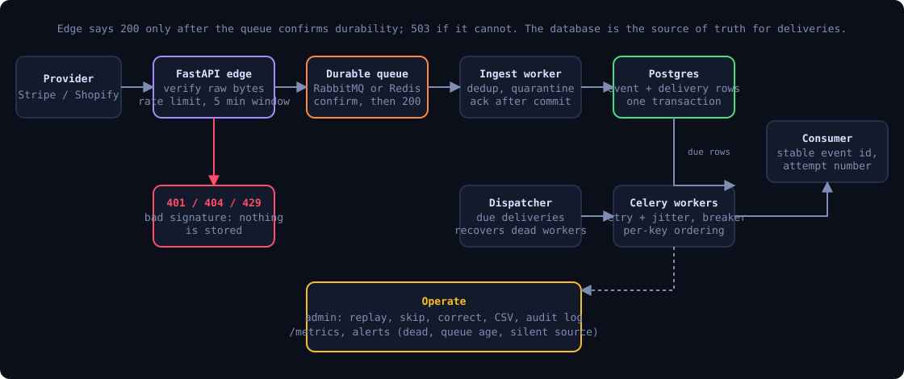
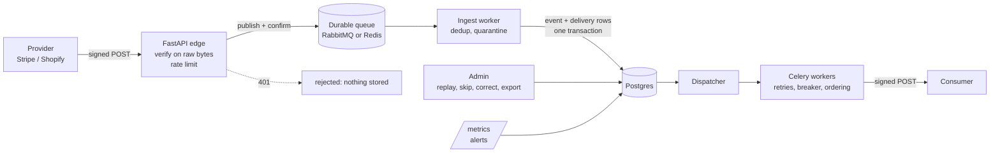

# Webhook gateway

One service that sits in front of a company's webhook handlers. It receives events, checks they are genuine, stores them
durably, delivers them reliably, and lets a human see, fix and replay any of them.

Webhooks are fire-and-forget. Without something like this, a script that is down for two minutes loses events, the same
order gets processed twice, anyone can POST to your URL, and when something breaks nobody can answer "did event X arrive,
and what happened to it?"

## Try it

```bash
./demo.sh                              # whole stack, retries slowed to a watchable pace
open http://localhost:8080/play/       # the animated playground
open http://localhost:8080/admin/      # admin / admin (dev only)
docker compose down -v                 # clean up
```

The playground is a 3D city where every building is a real part of the gateway: launch pads fire real signed
Stripe-style and Shopify-style webhooks at the real edge, a queue tube fills up, delivery drones fly to consumers, and
failed deliveries end up in a graveyard you can replay from. You can ride along with one webhook for its whole journey.
Nothing on the page is mocked. It also has a **crash the queue** button that `kill -9`s the broker mid-flight and reports
what survived. More in [docs/PLAYGROUND.md](docs/PLAYGROUND.md).

## How it works





1. The **edge** (FastAPI) verifies the signature on the raw body, then puts the event on a durable queue and answers 200
   only after the queue confirms.
2. The **ingest worker** drops duplicates and stores the event, plus one delivery row per subscriber, in one Postgres
   transaction.
3. The **dispatcher** and **Celery workers** deliver with retries, backoff, a circuit breaker and optional per-key ordering.
4. The **admin** shows every event's life and lets a human replay, skip or correct it.

## What it promises

1. **No accepted event is lost.** The edge says 200 only after the queue has confirmed the message is durable. If the queue
   cannot confirm, the edge answers 503 and the provider retries. It never answers a false 200.
2. **At-least-once delivery, not "exactly once".** Exactly-once over a network is not possible: if the consumer's reply is
   lost, we cannot know whether it processed the event, so we send again. Every delivery carries the same stable event id
   (`X-Gateway-Event-Id`) and an attempt number, so a consumer can ignore repeats. Duplicates from the *provider* are dropped
   at the door.
3. **A failing consumer never blocks another.** Per-consumer in-flight cap, retries with backoff and jitter, and a circuit
   breaker. Events wait; none are dropped.
4. **Every event has a visible life**: received, stored, queued, every attempt with timings and response codes, replays,
   and who did what.
5. **A human can find any event in under a minute and replay it**, one at a time or in bulk (dry run first, rate limited).

The full feature list is in [docs/FEATURES.md](docs/FEATURES.md), and the reasons behind each decision are in
[docs/DECISIONS.md](docs/DECISIONS.md).

## Proof

Everything is run against the real stack (real edge, real broker, real worker, real Postgres). `./e2e/run_all.sh` starts
six isolated stacks and runs every shard in parallel, in about three minutes.

| Test | Result |
|---|---|
| Core down, 500 signed events sent, then restarted | 500 accepted, 500 stored exactly once |
| Broker down | every request answered 503, none stored; edge recovers on its own |
| `kill -9` the broker with 300 acknowledged events only inside it | RabbitMQ 300/300 survived, Redis with AOF 300/300, Redis with no persistence 0/300 |
| `kill -9` a worker mid-delivery | redelivered after restart, same event id |
| Load: 50 events/s for 5 minutes, 8% duplicates, 4% bad signatures, a consumer failing 30% of requests | 14,357 unique events stored once and all delivered; 1,127/1,127 duplicates absorbed; 643/643 bad signatures rejected; edge p99 16 ms |

The full tables, how to read them, and the mistakes the load test uncovered are in [docs/PROOF.md](docs/PROOF.md).

**Scaling:** one ingest worker stores about 75 events per second, three about 138 (the shared Postgres is the limit).
Ordered subscriptions need a single ingest worker. Details are in [docs/PROOF.md](docs/PROOF.md#scaling).

## Honest limits

- **Provider details are from memory.** The Stripe-style and Shopify-style signature schemes follow the providers' public
  documentation as I know it; check each against the current docs before pointing real traffic at it.
- **The consumer in every test is a fake** (`fake_consumer/`), and the "provider" is a script that signs like one. No real
  Stripe or Shopify traffic has been run through this.
- **Redis `everysec` / `no` durability on power loss is not tested.** `kill -9` kills the process, not the machine.
- **Single operator.** One superuser, no roles, no multi-tenancy, by decision. The dev login is `admin`/`admin`.
- **The playground is dev only**: it signs webhooks with the dev secrets in the database. Set `PLAYGROUND=0` to turn it off.
  The crash button mounts the Docker socket, so it is only enabled by `demo.sh` and must never be exposed publicly.
- **One Postgres.** No read replica, sharding or connection pooling.
- **Not built:** shadow mode (comparing against the old scripts needs their real event history).

## Layout

```
edge/            FastAPI edge: signatures, rate limit, publishers (RabbitMQ, Redis), tests
core/            Django: models, ingest, delivery engine, admin, metrics, alerts, retention, playground
fake_consumer/   controllable fake consumer used by the tests and the playground
e2e/             crash tests, delivery scenarios, load test, startup soak test, parallel runner (run_all.sh)
docs/            DECISIONS.md, FEATURES.md, PROOF.md, PLAYGROUND.md, architecture.svg
demo.sh          start everything with watchable timings
```

Send an event yourself: sign `"<timestamp>.<body>"` with a source secret from `dev/sources.json` (see `e2e/crash_tests.py`
for a ten-line signer). Unit tests: `docker compose --profile test up core-test` (core) and `cd edge && pytest` (edge).
Production values are the defaults; test and demo stacks scale time down with `DELIVERY_TIME_SCALE`.
